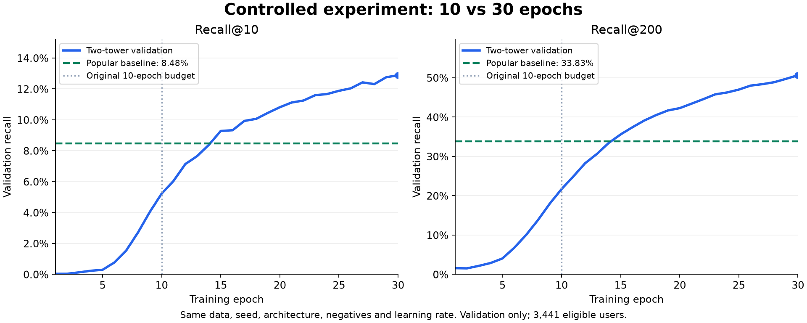

# Retrieval diagnosis — October 13, 2026

## Conclusion

The initial ten-epoch training budget was insufficient for this configuration on this validation task. Increasing only the epoch budget to thirty raised validation Recall@200 from 21.68% to 50.64%, above the popular baseline's 33.83%. This supports insufficient optimization as an important contributor to the original gap; it does not establish a universal best epoch budget or online engagement improvement.

## Controlled experiment

Both runs used the same prepared data and mapping fingerprints, CPU runtime, seed 42, tower structure, 32-dimensional vectors, five negatives, batch size 256, Adam learning rate 0.001, and evaluation protocol. Only epochs changed from 10 to 30. The first ten losses and validation metric sets matched the original run exactly.

Thirty epochs completed in 430.67 seconds. Checkpoint selection used validation Recall@200 with earlier tie retention. Epoch 30 was selected because it had the highest metric, not simply because it was last. The saved model was reloaded independently for diagnostics and reproduced the recorded aggregate recall. The frozen test period was not read or evaluated.

| Validation metric | Popular | Ten-epoch model | Thirty-epoch model |
|---|---:|---:|---:|
| Recall@10 | 8.48% | 5.22% | 12.88% |
| Recall@200 | 33.83% | 21.68% | 50.64% |
| NDCG@10 | 0.07486 | 0.03845 | 0.10071 |
| NDCG@200 | 0.14097 | 0.07970 | 0.19946 |

All comparisons use the same 3,441 eligible training-known users and 19,861-channel training catalog. Repeat-viewed channels remain eligible. Recall@200 first surpassed popularity at epoch 15. All four reported metrics surpassed the baseline by epoch 17. The primary selection metric continued improving through epoch 30; small fluctuations in other metrics do not by themselves prove overfitting. Behavior beyond thirty epochs is unknown.



## Data findings

The training sample has 103,280 observations across 4,802 users. A user's median history contains 12 observations across 8 distinct channels. There are 1,029 users with at most five training observations. Of 19,861 training channels, 16,752 (84.35%) have at most five observations, and the median channel has one. The sample has a substantial sparse tail.

The top 200 channels by distinct-user popularity occupy 1.01% of the catalog but account for 29.84% of training observations and 32.85% of eligible distinct validation user–channel pairs. That last fraction is pair-weighted coverage, distinct from the baseline's equally user-weighted Recall@200 of 33.83%. These findings explain why popularity is a meaningful competitor, but do not isolate sparsity as the cause of the initial model's deficit.

## Results by user history

Buckets are based only on training observation counts. Each metric is averaged over eligible users within that bucket.

| Training observations | Eligible users | Popular Recall@200 | Ten epochs | Thirty epochs |
|---|---:|---:|---:|---:|
| 1–5 | 586 | 37.49% | 14.82% | 43.01% |
| 6–20 | 1,387 | 34.73% | 23.58% | 51.61% |
| 21–100 | 1,383 | 32.06% | 22.69% | 52.96% |
| 101+ | 85 | 22.66% | 21.50% | 49.53% |

The longer-trained model exceeds popularity in every inspected history bucket, including short histories. The smallest bucket has only 85 eligible users; no significance claim or confidence interval is made. Unknown users and channels remain outside the primary personalized metrics and are accounted for in the coverage reports.

## Verification and next step

Data fingerprints and unchanged hyperparameters were checked; all ten repeated prefix epochs match. Bucket counts sum to the same 3,441 users, and weighted bucket recall reproduces the saved model and baseline aggregate metrics. The existing 26 automated checks still pass. Model source and repository defaults were unchanged; this was an experiment using a separate YAML file and output directory.

The new selected weights are in the existing checkout at `artifacts/retrieval-30epochs-v001/best_model.pt`. Recommend using this checkpoint for the next FAISS export and retrieval-service milestone after review. Preserve the popular fallback and continue reserving the test set for final pipeline evaluation. Additional architecture or sampling changes are not justified solely by the now-resolved initial aggregate deficit.

## Reproduce and inspect

From the repository root:

```bash
.venv/bin/python -m recommendation.train --prepared data/prepared --output artifacts/my-30epochs-run --config docs/notes/Training-30-Epochs.yaml
```

Choose a fresh output directory. This runs training, not just a prediction.

- [Thirty-epoch configuration](Training-30-Epochs.yaml)
- [Validation comparison](Thirty-Epoch-Validation-Comparison.json)
- [Per-epoch history](Thirty-Epoch-Training-History.json)
- [Ten-epoch diagnostics](Retrieval-Diagnostics-10-Epochs.json)
- [Thirty-epoch diagnostics](Retrieval-Diagnostics-30-Epochs.json)
