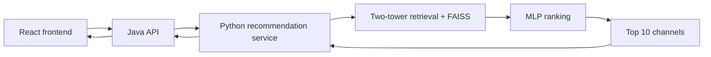

# TwitchRecommender — High-Level Design

**v0.1 | October 10, 2026 | Draft for review**

## Purpose and scope

Build a personalized channel recommender with a web frontend. V1 learns from historical Twitch interactions and runs on one computer with no additional paid services. Live-stream filtering is deferred, so recommendations do not imply that a channel is currently live.

## System architecture

The React frontend lets a person choose a demo user, view recommendations, and open a channel on Twitch. The existing Java backend handles application requests and stable experiment assignment. A Python service owns recommendation serving and event storage.

Keeping Java preserves the existing backend; Python supports model training and serving directly. This introduces a service boundary but gives each backend a clear responsibility.

## Offline data flow

Historical interactions are cleaned and split chronologically into training, validation, and test periods. PyTorch trains the retrieval and ranking models. Training produces a versioned bundle containing model weights, channel vectors, the FAISS index, ID mappings, feature metadata, and a popular-channel list.

Features use only information available before the relevant prediction time. The proposed Twitch100k data contains implicit observations, not recommendation exposure or click labels. Offline evaluation compares popular recommendations, retrieval alone, and retrieval plus ranking using Recall and NDCG.

## Online recommendation flow

Java assigns the selected user to a stable experiment variant. The baseline variant returns popular channels. The personalized variant uses a two-tower model to retrieve approximately 200 candidates, then an MLP ranks them. Final selection removes duplicates and returns up to 10 channels. Previously watched channels remain eligible.

The frontend records exposures after results are displayed and associates clicks with those exposures. Events pass through Java to Python and are stored in SQLite. Historical training data and newly collected frontend events remain separate in v1.

## Reliability and versioning

Unknown users and recoverable recommendation failures receive popular recommendations. Java keeps a popular-channel snapshot for cases where Python is unreachable. If no valid fallback exists, the frontend shows a clear error.

Models, vectors, indexes, and mappings are loaded as one compatible version. Responses and events identify the model and experiment versions. A previous working bundle supports rollback.

## Measurement and boundaries

The system measures recommendation quality offline and service latency, throughput, errors, and fallback frequency locally. Performance targets follow initial measurements on the actual computer.

Stable baseline/personalized assignment and linked exposure/click events provide an A/B experiment framework. Demonstration traffic verifies the framework; it cannot establish real engagement lift. Distributed infrastructure, automatic retraining, authentication, and ReAct agents are outside v1.
